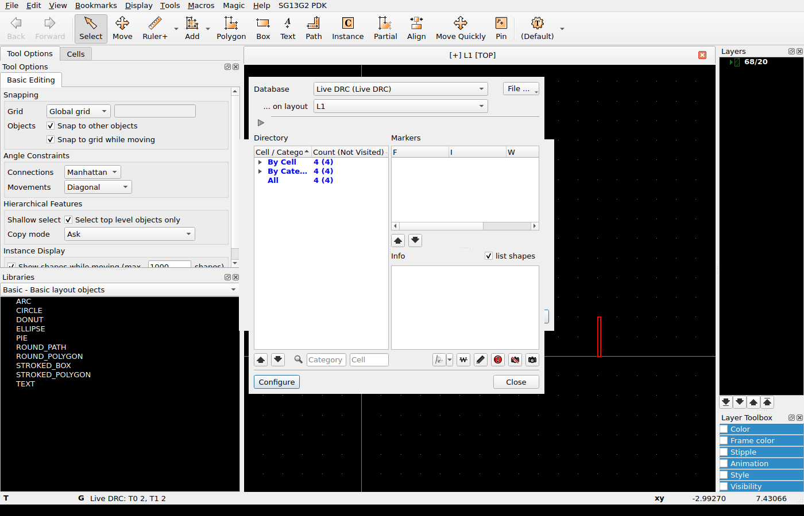

# klayout-live-verify

Live DRC for KLayout. This is Phase 5 of `/foss/designs/plan/roadmap.md`.
It is a Salt package: link this folder into `~/.klayout/salt/`, the way
`/foss/designs/dev-klayout.sh` does.

## Use

Tools > Live verify:

| Entry | Key | What it does |
|---|---|---|
| DRC visible area | Ctrl+Alt+D | Checks the view. Tier 0 (in-process width/space) at once, then the PDK's KLayout deck in the background. Opens the Marker Browser on "Live DRC" |
| Live DRC | Ctrl+Alt+L | On/off. Once a second the visible geometry is compared with the last look. When an edit settles, only the changed area (at least 5 um, plus a 2 um halo) is checked. Markers found earlier elsewhere stay |
| Clear live DRC markers | | |

Violations show as red markers on the canvas and in the Marker Browser,
with categories `T0 <layer> width/space < x` and `T1 <deck rule>`. The
PDK is the layout's technology, then `$PDK`: sky130A (`sky130A_mr.drc`) and
gf180mcuD (`gf180mcu.drc`, decks=all,-density, variant D).



## How a check works

1. **Clip.** `clip.py` flattens the area plus the halo into a temporary
   cell.
2. **Tier 0.** `tier0.py` runs Region width/space checks, in a few
   milliseconds.
3. **Tier 1.** `deck.py` writes the clip as GDS and runs the PDK deck
   (`sky130A_mr.drc`, feol/beol/offgrid) as a separate `klayout -b`
   process.
4. **Filter.** `results.py` keeps markers that touch the area and drops
   those within half a halo of the clip's edge, because cutting the
   layout causes those.
5. **Dirty area.** `dirty.py` XORs the view's geometry against the
   previous snapshot. KLayout has no "layout changed" event, so polling
   the geometry catches every kind of edit.

## Tests

```
klayout -b -r tests/run.py          # or python3 tests/run.py
tools/gui_check.sh                  # the GUI under Xvfb (needs ../klayout-power-pcells/tools/screenshots/qtdrive.py)
```

## Next (from CLAUDE.md)

- Tier 2: Magic DRC through one long-lived Magic per PDK. klayout-magic-pcells
  already runs Magic's DRC from its Magic menu; the backend there can be
  reused.
- An on-demand LVS panel: extract, netgen, and a mismatch list that
  cross-highlights nets.
- The IHP decks.
