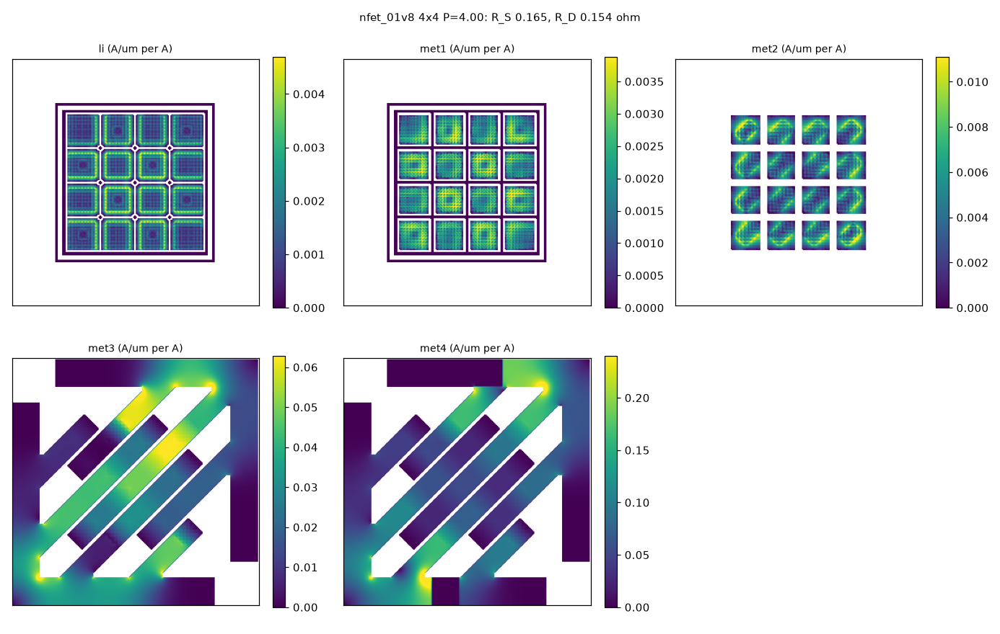

# HW_FET analysis tools

Roadmap Phase 2 (`/foss/designs/plan/roadmap.md`): numbers you can do
research with, computed from the generator's own geometry.

## Metal resistance: `ron`

```
PYTHONPATH=python python3 -m klayout_power_pcells ron nx=4 ny=4 P=4 [runner_style=planes] [--pixel 0.1] [--heatmap map.png]
```

`ron.ron_metal(WaffleParams)` returns R_S, R_D (metal only, ohm) and the
licon contact term:

- **The mesh.** Every metal from li to met5 is rasterized into square
  pixels: one node each, with 1/R_sheet to each neighbour. Every cut
  layer joins the pixels above and below with (cut area in the pixel /
  one cut's area) / R_cut.
- **The currents.** The S and D pins are grounded, and every S (D) square
  injects an equal share of 1 A at the li over its licon cuts. This
  assumes the channel dominates, so the squares carry equal current.
- **The result.** R_net = Σ I_k V_k / I², the resistance that dissipates
  the same power. The licon contacts add Σ I_sq² R_c / n_cuts.
- **Resistance values.** They are Magic's sky130A extraction values (from
  the PDK's tech file): li 12.8, met1/met2 0.125, met3/met4 0.047, met5
  0.029 ohm/sq; mcon 9.3, via 4.5, via2/via3 3.41, via4 0.38, licon 185
  (n) / 585 (p) ohm per cut.
- **Safety checks.** A pixel coarse enough to short S to D, or an S/D
  square cut off from its pin, is refused.



sky130 nfet_01v8, P = 4 um, 0.1 um pixels:

| nx = ny | runners | R_S | R_D | R_S + R_D | licon |
|---|---|---|---|---|---|
| 2 | diag45 | 0.380 | 0.317 | 0.696 | 1.597 |
| 4 | diag45 | 0.165 | 0.154 | 0.319 | 0.404 |
| 6 | diag45 | 0.136 | 0.132 | 0.268 | 0.180 |
| 4 | planes | 0.084 | 0.082 | 0.166 | 0.404 |
| 4 | staircase | 0.214 | 0.192 | 0.406 | 0.404 |

Validation (`tests/power/test_ron.py`):

- **Analytic strips.** A 10 x 1 um met1 strip with current injected at
  the end, and uniformly along it, is within 2 % of Rs·L/W and Rs·L/3W.
- **Via array.** Four vias between met1 and met2 give 4.5/4 ohm.
- **Mesh convergence.** The HW_FET result at 0.1 um and at 0.05 um
  pixels agrees within 5 %.
- **Not done yet.** The comparison with Magic `extresist` that the plan
  asks for. The model also leaves out the diffusion under each square and
  any current crowding toward the gates.
