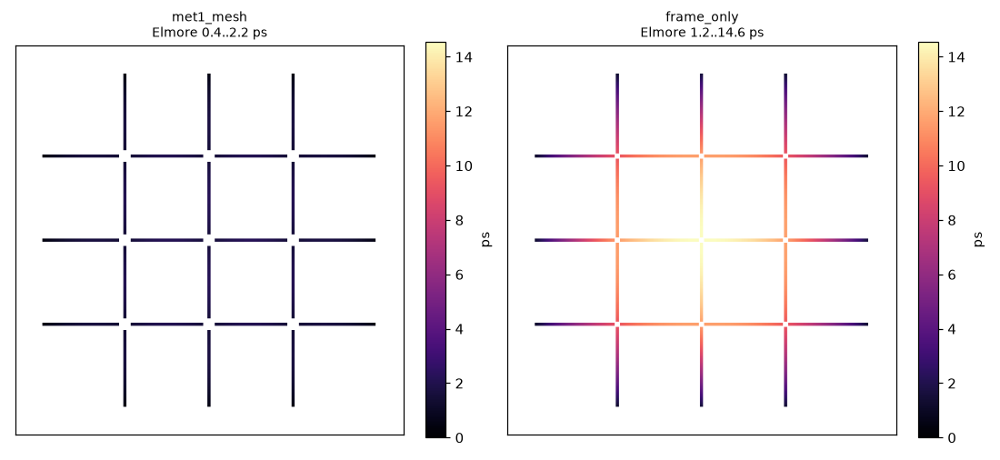
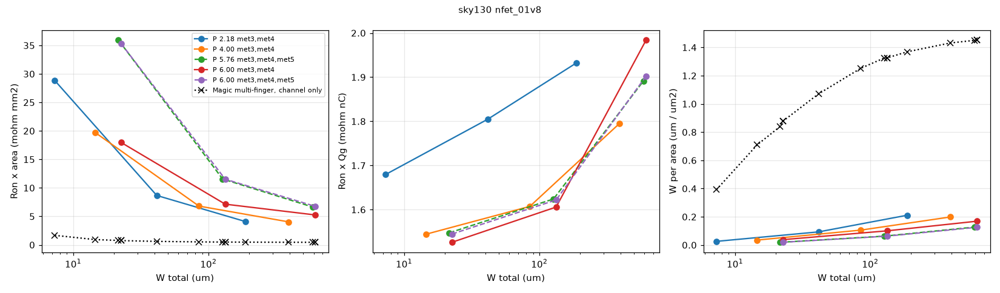

# HW_FET analysis tools

Roadmap Phase 2 (`/foss/designs/plan/roadmap.md`): numbers you can do
research with, computed from the generator's own geometry.

## Metal resistance: `ron`

```
PYTHONPATH=python python3 -m klayout_power_pcells ron nx=4 ny=4 P=4 [runner_style=planes] [--pixel 0.1] [--heatmap map.png]
```

`ron.ron_metal(WaffleParams)` returns R_S, R_D (metal only, ohm) and the
licon contact term:

- **The mesh.** Every metal from li to met5 is rasterized into square
  pixels: one node each, with 1/R_sheet to each neighbour. Every cut
  layer joins the pixels above and below with (cut area in the pixel /
  one cut's area) / R_cut.
- **The currents.** The S and D pins are grounded, and every S (D) square
  injects an equal share of 1 A at the li over its licon cuts. This
  assumes the channel dominates, so the squares carry equal current.
- **The result.** R_net = Σ I_k V_k / I², the resistance that dissipates
  the same power. The licon contacts add Σ I_sq² R_c / n_cuts.
- **Resistance values.** They are Magic's sky130A extraction values (from
  the PDK's tech file): li 12.8, met1/met2 0.125, met3/met4 0.047, met5
  0.029 ohm/sq; mcon 9.3, via 4.5, via2/via3 3.41, via4 0.38, licon 185
  (n) / 585 (p) ohm per cut.
- **Safety checks.** A pixel coarse enough to short S to D, or an S/D
  square cut off from its pin, is refused.


sky130 nfet_01v8, P = 4 um, 0.1 um pixels:

| nx = ny | runners | R_S | R_D | R_S + R_D | licon |
|---|---|---|---|---|---|
| 2 | diag45 | 0.380 | 0.317 | 0.696 | 1.597 |
| 4 | diag45 | 0.165 | 0.154 | 0.319 | 0.404 |
| 6 | diag45 | 0.136 | 0.132 | 0.268 | 0.180 |
| 4 | planes | 0.084 | 0.082 | 0.166 | 0.404 |
| 4 | staircase | 0.214 | 0.192 | 0.406 | 0.404 |

Validation (`tests/power/test_ron.py`):

- **Analytic strips.** A 10 x 1 um met1 strip with current injected at
  the end, and uniformly along it, is within 2 % of Rs·L/W and Rs·L/3W.
- **Via array.** Four vias between met1 and met2 give 4.5/4 ohm.
- **Mesh convergence.** The HW_FET result at 0.1 um and at 0.05 um
  pixels agrees within 5 %.
- **Not done yet.** The comparison with Magic `extresist` that the plan
  asks for. The model also leaves out the diffusion under each square and
  any current crowding toward the gates.

## Gate RC: `gate`

```
PYTHONPATH=python python3 -m klayout_power_pcells gate nx=4 ny=4 P=4 [--rdrive 50] [--cox 8.4] [--compare maps.png]
```

`gate.gate_delay(WaffleParams)` meshes the gate net the same way:

- **The network.** Poly at 48.2 ohm/sq, poly contacts at 152 ohm per
  cut, then li, mcon and the met1 strap. Every poly pixel over the
  channel carries C_ox × its area to the source.
- **The drive.** The G pin is driven with a 1 V step, optionally through
  a driver resistance.
- **The outputs.** Elmore delays (one sparse solve) for every channel
  pixel, t50 and t90 from a backward-Euler transient, and
  `export_spice()` for ngspice.
- **About C_ox.** The default of 8.4 fF/um² is ε_ox / t_ox for a ~4.1 nm
  oxide, an *estimate* for sky130's 1.8 V devices. It scales every time
  equally, so the comparison between straps doesn't depend on it.



nfet_01v8, 4 x 4, P = 4 um, C_gate 0.107 pF, ideal driver:

| gate strap | Elmore min..max | t90 min..max |
|---|---|---|
| met1_mesh | 0.40..2.18 ps | 1.24..4.90 ps |
| frame_only | 1.17..14.6 ps | 1.99..29.9 ps |

With the frame-only strap, the gates in the middle of the array turn on
about 6x later than with the met1 mesh, because the poly is the only path
to them.

Validation (`tests/power/test_gate.py`):

- **RC line.** A uniform poly RC line's Elmore delay is within 3 % of
  RC/2.
- **Gate capacitance.** C_gate = W·L·C_ox.
- **Against ngspice.** The Python t50 and t90 agree within 6 % with
  ngspice on the exported deck. Backward Euler runs a few percent slow.

## Design-space sweep: `sweep`

```
KMP_PDKS=sky130A PYTHONPATH=python python3 -m klayout_power_pcells sweep --P 0,4,6 --nx 2,4,8 -o out
```

For every P × nx × runner set, `sweep.point()` reports:

- **Geometry.** W, the drawn area (bounding box, with guard ring and
  buses), the drawn W/area, and the core W/area (the nx·ny·P² array
  alone).
- **Ron.** r_ch/W + R_metal + the licon contacts. r_ch comes from
  ngspice with the PDK's tt models, in the linear region at Vgs = 1.8 V
  and Vds = 50 mV: 657 Ω·µm for nfet_01v8 at L = 0.15.
- **Qg.** q_g × W, where q_g is the model's full gate charge, measured
  by charging the gate from a constant current: 2.24 fC/µm. That agrees
  with the 8.4 fF/µm² C_ox estimate used by the gate RC model, which
  predicts 2.27.
- **Figures of merit.** Ron × area and Ron × Qg.

The baseline is Magic's multi-finger device of the same total W (fingers
about 5 um wide, with guard ring): its drawn area, and a channel-only
Ron. That favours the finger FET, because its metal isn't counted.



What the sweep shows (nfet_01v8, L 0.15, diag45):

| P (um) | nx | runners | W (um) | W/area drawn | W/area core | finger W/area | Ron·A (mΩ·mm²) | finger, channel only |
|---|---|---|---|---|---|---|---|---|
| 2.18 (min) | 8 | met3,met4 | 188 | 0.21 | 0.62 | 1.37 | 4.09 | 0.48 |
| 4.00 | 8 | met3,met4 | 392 | 0.20 | 0.38 | 1.43 | 4.04 | 0.46 |
| 6.00 | 8 | met3,met4 | 616 | 0.17 | 0.27 | 1.45 | 5.25 | 0.45 |
| 5.76 (min) | 8 | met3,met4,met5 | 589 | 0.13 | 0.28 | 1.45 | 6.65 | 0.45 |

- **W per area is worse than the finger device.** In this generator,
  HW_FET has a lower W/area than Magic's multi-finger device even in the
  core. Its W/area ≈ 2(P − N)/P², and P cannot go below 2.18 um because
  the S/D runners need that pitch (5.76 um with met5). That is the main
  thing the ISPSD 2008 comparison depends on, and the open question for
  the plan.
- **Periphery.** At nx ≤ 8 the guard ring and buses take most of the
  drawn area, so the drawn W/area keeps rising with nx.
- **Ron·Qg.** It is nearly flat (1.5–2.0 mΩ·nC), because Ron and Qg both
  scale with W. It rises slowly with W as the metal's share grows.
- **Not yet a fair Ron·area comparison.** That needs the finger device's
  own metal routed and extracted (the same ron.Mesh can do it). Until
  then the finger column is a lower bound.
