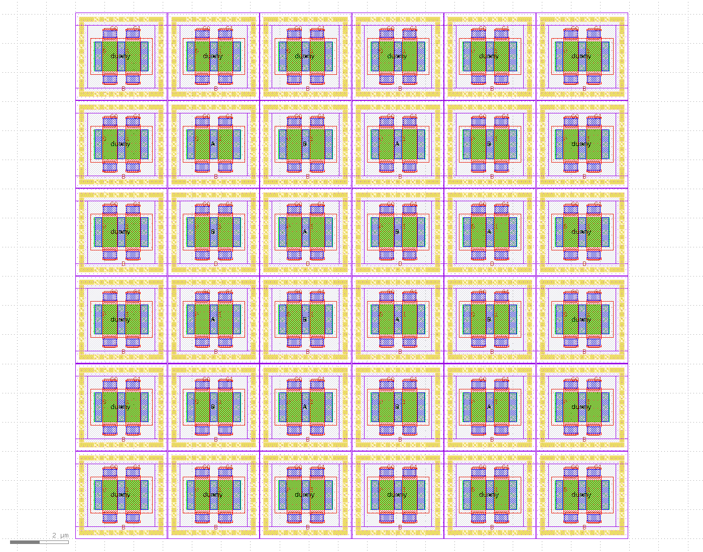
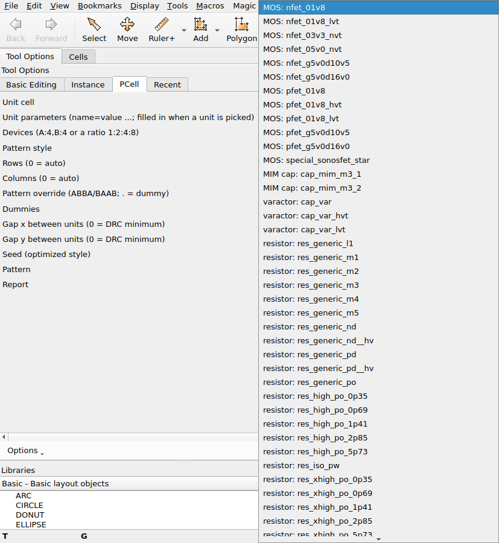

# CC_ARRAY: common-centroid matched arrays

`python/klayout_centroid` turns device unit counts into a common-centroid
array of unit cells, with dummies. The unit cells come from the `*_magic`
libraries of klayout-magic-pcells. It follows the prep notes in
`/foss/designs/plan/centroid.md`, milestones 1 to 5.



## In KLayout

The Salt package registers a library named `centroid` with one PCell,
`CC_ARRAY` (autorun macro `pymacros/klayout_centroid.lym`). Place it from
the library browser and set:

| Parameter | Meaning |
|---|---|
| Unit cell | a dropdown of every device in the registered `*_magic` libraries, grouped MOS, MIM cap, varactor, resistor, diode, fixed cell (box-paint generators such as vias are left out); with more than one PDK registered, each entry starts with its PDK |
| Unit parameters | `w=1 l=0.5 nf=2 guard=1`: any parameters of that PCell, typed after its declaration. Picking a unit fills in its size parameters (w, l, nf, nx, ny, guard) unless you have typed your own that fit the new unit. For MOS the offer is at least w=1, l=0.5, nf=2, because Magic's minimum-size defaults break m1.6 on their own |
| Devices | `A:4,B:4`, or a bare ratio `1:2:4:8` (named A, B, C, ...). Names are one letter or digit |
| Pattern style | `interdigitated`, `checkerboard`, `symmetric`, `optimized` (default) |
| Rows, Columns | 0 = automatic (fewest dummies traded against a square footprint in um) |
| Pattern override | a hand-written grid such as `ABBA/BAAB` (`.` = dummy); refused unless it is common-centroid |
| Dummies | full ring, left/right columns, or none |
| Gap x, Gap y | space between unit bounding boxes; 0 = the DRC minimum for the PDK (sky130A only so far) |
| Seed | for the optimized style |
| Labels | on by default: each unit gets a text with its device name (`A`, `B`, ..., `dummy`) at its centre |



The read-only **Pattern** and **Report** fields show the letter grid and one
summary line. Values that can't be drawn put an error icon on the parameter
to blame, and the cell shows a 1 x 1 um box with a `CC_ERROR` text on 255/0.

The labels are texts on `81/79` (areaid.analog) in sky130A, never on a
layer that extraction reads: a text `A` on li or met1 would become a net
name and join every A unit into one net. Magic ignores 81/79, the LVS deck
doesn't read it, and the DRC deck declares it only as polygons. The
extraction test runs with labels on and still finds no shared nets. PDKs
without a rule table get no labels yet. To see the labels in KLayout, make
81/79 visible.

Each instance also carries property 1, `device=<name>;row=<i>;col=<j>`
(`device=dummy` for dummies). GDS keeps it as a PROPATTR, so that a later
router or LVS step can use it. Row 0 is the top row.

## From the command line

```
cd python
python3 -m klayout_centroid A:4,B:4 --style optimized      # grid + full report
python3 -m klayout_centroid 1:2:4:8:16 --compare           # one line per style
python3 -m klayout_centroid A:2,B:2 --override ABBA/BAAB   # check a hand-made grid
```

The pattern core (`pattern.py`, `metrics.py`) does not import KLayout, so
other flows such as gdsfactory or Glayout can use it too.

## How a pattern is built

All the constructions keep every device's centroid exactly at the array
centre. This is checked with exact fractions before anything is drawn.

- **Symmetric pairs.** A cell and its 180 degree mirror always hold the
  same device.
- **Odd counts.** The first device with an odd count takes the centre cell
  (only an odd x odd grid has one). Each further odd device takes a
  *triad*: three cells {a, b, -(a+b)} whose centroid is the centre. Triads
  come in mirrored pairs, so the remaining cells still pair up. This is
  why 3:5 fits on a 3 x 3 grid (`BAB/B.A/ABB`), which pure point symmetry
  cannot do. Two devices with a single unit each are refused, because only
  one unit can sit on the centre.
- **Dummies.** Cells not used by a device are dummies, also placed in
  pairs, on the outermost cells.
- **Styles.**
  - `interdigitated`: raster order, so 1 x 4 gives `ABBA`.
  - `checkerboard`: one colour first, so 2 x 2 gives `AB/BA` and the
    pattern tiles.
  - `symmetric`: radial order, suited to ratioed capacitor arrays.
  - `optimized`: starts from the best of the three constructions above,
    then anneals swaps of symmetric pairs. It is never worse than the
    constructive styles, and every swap keeps the common centroid.

## The report

- **centroid**: each device's centroid offset from the array centre. It is
  0 for every generated pattern.
- **sigma**: the standard deviation of (mean of device k) - (mean of
  device m), in units of one cell's sigma, under a spatially correlated
  random field ρ^distance with ρ = 0.9 per pitch. This is the
  correlation-coefficient index (Huang/Wey 2013, Lin 2011), and it is
  what the optimizer minimizes.
- **dispersion**: the first-pass nearest-same-device score from the prep
  notes.
- **adjacency**: neighbour counts per device pair, left/right and
  above/below.
- **gradient**: the device-mean mismatch under a synthetic gradient. The
  linear term always cancels; the x², y² and x·y terms show what a common
  centroid leaves behind (Sharma 2021).

## Placement and DRC

- **Same orientation.** Every unit is the same cell in the same
  orientation (R0), so current flows the same way in each.
- **Automatic gap (sky130A).** The gap is the smallest one on the 5 nm
  grid that keeps diffusion, tap, poly, the cuts and the metals of
  neighbouring units at their spacing. It is computed from how far inside
  the unit's bounding box each layer sits; the table is in `rules.py`.
- **Wells and implants.** Nwell, nsdm, psdm, npc, lvtn, hvtp, hvi and
  hvntm gaps narrower than their spacing are bridged with fill shapes in
  the array cell. Fill never overlaps the opposite implant.
- **Other PDKs.** gf180mcuD and the IHP PDKs have no table yet, so give
  the gaps explicitly.
- **MIM caps and poly resistors.** capm and cap2m keep 0.84 um apart, and a MIM
  cap's bottom-plate metal keeps 1.2 um (capm.2b, cap2m.2b). rpm and urpm are
  merged like implants.

What the tests check (`tests/centroid`, sky130A, Magic 8.3 and the PDK's
KLayout deck):

| Array | KLayout DRC | Magic DRC |
|---|---|---|
| nfet, pfet units without guard ring (ring, none) | clean | only LU.2/LU.3 (no tap within 15 um) and nwell.4 (no n-tap in the merged well), because the units have no taps |
| nfet units with guard ring (edge columns, ring, 1:2:4:8) | clean | clean |

With the offered parameters, 2 x 2 arrays with a dummy ring are clean in KLayout's deck for
nfet_01v8_lvt, pfet_01v8, pfet_01v8_hvt, the 5 V nfet and pfet, cap_mim_m3_1 and res_generic_po.
cap_mim_m3_2 (m5.4), res_xhigh_po_0p69 (urpm.1a), res_high_po_0p35 (rpm.1a) and cap_var_lvt (m1.6)
break one rule already as a single unit at those sizes; the array adds nothing.

Magic extraction of a flattened 4 x 6 array with two-finger units finds
48 devices on 72 separate S/D nets, so no unit shorts to another.

The GUI form is checked under Xvfb by `tools/screenshots/cc_shots.sh`. It
opens the form, picks a MIM cap in the dropdown and records the fields, and
it also made the screenshot above.

Run the tests:

```
python3 -m unittest discover -s tests/centroid -t .                      # pattern core only without Magic
KMP_PDKS=sky130A KMP_PDK=sky130A python3 -m unittest discover -s tests/centroid -t .   # all, about 40 s
```

## Limits and next steps

- **No routing yet.** The array is placed, not routed. The instance
  properties give each unit's device, and the next step is a balanced
  track router: one horizontal track per device per row, swapped on
  alternate rows. After that comes LVS of a routed diff pair.
- **No diffusion sharing between units.** Each unit is a separate
  device. Sharing needs multi-finger rows built by the generator itself.
- **Unit size.** `sky130_fd_pr__nfet_01v8` at w=0.6 l=0.15 nf=1 guard=1
  breaks m1.6 (met1 area) in the PDK's KLayout deck on its own, before any
  placement. Choose unit sizes that are clean alone.
- **Pattern core is our own.** It is not a port of pmicgen, so pmicgen's
  licence does not apply. The triad construction for extra odd counts is
  our own as well.
