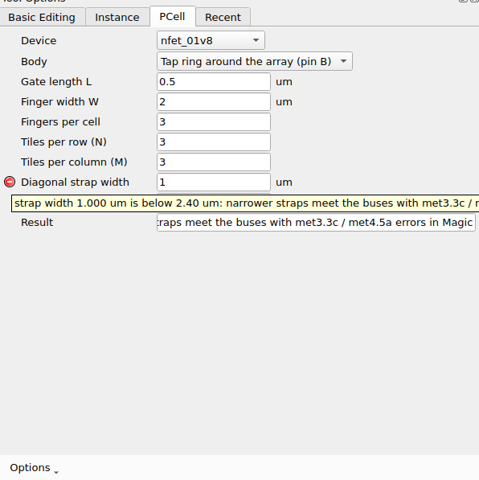
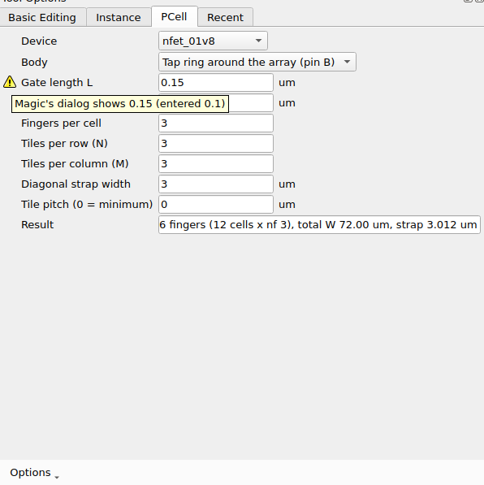
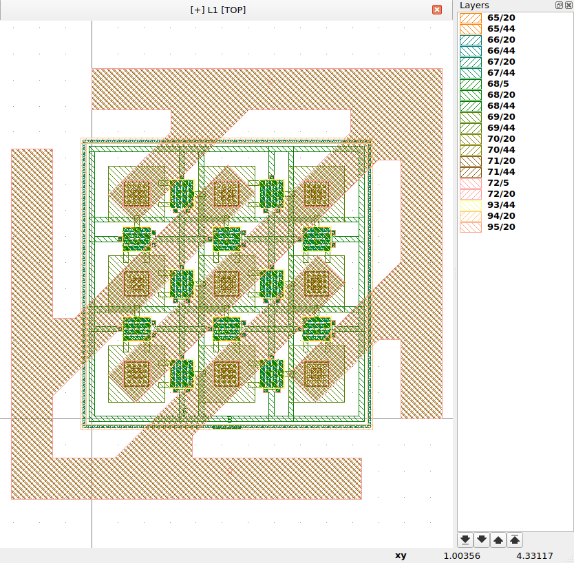

# sky130_power: the HW_FET PCell in KLayout

`sky130_power` is a KLayout library with one PCell, `HW_FET`: a sky130A
hybrid-waffle power MOSFET. Magic's own generators draw every transistor,
via, tap and well in it, through klayout-magic-pcells' `sky130_magic`
library. [hybrid_waffle.md](hybrid_waffle.md) describes the geometry and the
limits; this guide covers using the plugin.

The screenshots were taken by `tools/screenshots/power_shots.sh` in KLayout
0.30.12 under Xvfb (Magic 8.3.685, sky130A). `tests/power/test_gui.py` runs
the same GUI sessions and checks what they show.

## Installing

This repository is one KLayout Salt package, `klayout-power-pcells`. It
holds both klayout-magic-pcells (the `sky130_magic`, `gf180mcu_magic`,
`sg13g2_magic` and `sg13cmos5l_magic` libraries) and `sky130_power`. Install
it **instead of** klayout-magic-pcells, not next to it:

```sh
git clone https://github.com/roshan0282/klayout-magic-pcells.git /foss/designs/klayout-power-pcells
git -C /foss/designs/klayout-power-pcells checkout hybrid-waffle-m1
mkdir -p ~/.klayout/salt
ln -s /foss/designs/klayout-power-pcells ~/.klayout/salt/klayout-power-pcells
```

When KLayout next starts, two autorun macros run in this order:
1. `pymacros/klayout_magic_pcells.lym` registers the Magic libraries;
2. `pymacros/klayout_power_pcells.lym` registers `sky130_power`.

Check the setup from a shell:

```sh
PYTHONPATH=/foss/designs/klayout-power-pcells/python python3 -m klayout_power_pcells doctor
```

`doctor` prints:
- the settings and where each came from;
- the running Magic and the sky130A versions;
- the stamp that new cells get;
- the cache directory;
- the time it took to draw a 2x2 HW_FET.

A line starting `PROBLEM:` names what is missing.

## Placing an HW_FET

`sky130_power` appears in the Libraries panel next to `sky130_magic`:


Choose `HW_FET` and the Instance tool. The PCell tab has these fields:

| Field | Meaning |
|---|---|
| Device | one of the nine MOSFETs |
| Body | tap ring, or taps in the source tiles |
| L, finger W, fingers per cell | each internal tile edge gets one Magic MOSFET with these |
| Tiles per row and column | the N x M grid |
| Diagonal strap width | the 45 degree met3-met5 straps |
| Tile pitch | 0 picks the minimum |
| Result | read-only: pitch, fingers, total W and strap width of what will be drawn |


### What the form tells you

The form marks problems as it updates, with the reason in the tool tip of
the icon:

- **An error** is on the parameter that makes the generator refuse the
  values, and the Result line says why. Placing the FET anyway draws the
  error marker described under [If something fails](#if-something-fails).
  Here the strap is narrower than 2.4 um, below which Magic's metal3/metal4
  wide-metal rules fail at the buses:

  

  The grid gets the error when a tap ring can't keep the diffusion within
  Magic's 15 um latch-up distance. The message then suggests "Tap in every
  source tile".
- **A warning** is on W, L or fingers when Magic's own dialog changes them
  for the unit device. The field then shows Magic's value, which is the one
  drawn and stored. Here L 0.1 became 0.15 (`Mos length must be >= 0.15 um`):

  

Click in the layout to place it:



### Editing

Select the instance and open Properties (`Q`). Every field can be changed
there, and the instance is drawn again on OK. Here the FET becomes a
`pfet_01v8` with a tap in every source tile, on a 5x5 grid:


With `KMP_LAZY=1` the form shows an Update button instead of drawing on
every edit.

## Saving and reopening

The parameters are stored in the file with the cell.
- **With the library registered:** reopening the file gives live HW_FET
  cells, drawn again from the disk cache or by Magic.
- **Without it (Magic missing):** the cells show as
  `<defunct>sky130_power.HW_FET`, with the geometry stored in the file.
  Saving keeps that geometry. Once the library registers again, the cells
  are live again.


## From Python

```python
import sys
sys.path.insert(0, "/foss/designs/klayout-power-pcells/python")
import klayout.db as db
import klayout_power_pcells as kpp

lib = kpp.register()       # the sky130_power library, or None with one logged error
v = kpp.form_values({"device": "sky130_fd_pr__pfet_01v8", "bulk": "source", "l": 0.1, "nx": 4, "ny": 4})
# v["l"] == 0.15 (what Magic's dialog shows); v["info"] is the Result line
ly = db.Layout()
top = ly.create_cell("TOP")
fet = ly.create_cell("HW_FET", "sky130_power", v)
top.insert(db.CellInstArray(fet.cell_index(), db.Trans()))
ly.write("fet.gds")
```

`form_values` gives what the GUI form stores. Without it, `create_cell`
draws Magic's values but keeps the ones it was given; KLayout only stores
corrected values from its form. This matches klayout-magic-pcells'
`dialog_values`.

In batch, name both macros:

```sh
klayout -b -rm pymacros/klayout_magic_pcells.lym -rm pymacros/klayout_power_pcells.lym -r script.py
```

For a flat cell without the library, use
`klayout_power_pcells.write_gds(HWParams(...), path)` or
`python3 -m klayout_power_pcells hw ...`.

## Command line

```sh
python3 -m klayout_power_pcells doctor
python3 -m klayout_power_pcells devices -v                 # the nine devices, Magic's W/L minimums, the parameters
python3 -m klayout_power_pcells check l=0.1 nx=6 ny=6      # what the form makes of these values, and why not
python3 -m klayout_power_pcells generate device=pfet_01v8 bulk=source nx=4 ny=4 -o fet.gds
python3 -m klayout_power_pcells audit design.gds --regen
python3 -m klayout_power_pcells cache stats                # also: prune, clear
```

Exit status:
- **0:** the FET is drawn;
- **1:** it isn't (the generator refuses the values, or the file gets the
  error marker), or `audit` finds a problem;
- **2:** a value isn't a number or isn't one of the choices.

```
$ python3 -m klayout_power_pcells check l=0.1 nx=6 ny=6
HW_FET: Magic's dialog shows l=0.15 (entered 0.1)
HW_FET: not drawn: diffusion lies 21.20 um from the nearest tap; Magic's LU rules allow 15 um. Use a smaller grid or bulk='source' (a tap in every source tile) (parameter nx)
```

## Configuration

`sky130_power` uses klayout-magic-pcells' settings (environment, then
`~/.config/klayout-magic-pcells/config.ini`, then defaults; see that
README's Configuration section):
- **`KMP_MAGIC`, `PDK_ROOT`:** find Magic and sky130A.
- **`KMP_PDKS`:** sky130A must be among the selected PDKs. HW_FET registers
  sky130A's library itself if needed, but setting `KMP_PDKS=sky130A` saves
  the other PDKs' Magic processes.
- **`KMP_CACHE_DIR`, `KMP_CACHE`:** the disk cache (below). `KMP_CACHE=0`
  keeps nothing between sessions.
- **`KMP_LAZY`:** the Update button.
- **`KMP_TIMEOUT`, `KMP_LOG`:** the Magic requests behind each FET.

## The cache

KLayout draws every PCell variant again when it opens a file. A large
HW_FET is a few hundred Magic-drawn cells assembled in Python, so the
finished FET is cached:
- **Location:** `<KMP_CACHE_DIR>/power/v1/<versions digest>/HW_FET/<key>.gds`,
  plus a JSON sidecar. The sidecar holds the request, the result numbers,
  the stamp and the SHA-256 of the GDS.
- **Key:** covers the request (floats at 12 significant digits, as
  klayout-magic-pcells writes them) and the sky130A Magic, PDK and
  generator-code versions. It also covers this package's cache format and
  the text of `hybrid_waffle.py`. A new Magic, PDK or generator therefore
  starts new entries.
- **Damage:** an entry whose GDS no longer matches its SHA-256 is deleted and
  drawn again.
- **Unwritable directory:** the library still registers, without the disk
  cache, and logs a warning that names `KMP_CACHE_DIR`.
- **Management:** `cache prune` deletes the old versions directories,
  `cache clear` deletes everything, and `cache stats` counts the entries.

## Stamps and audit

Every HW_FET variant carries two stamps of the form
`hw1;version=0.3.0;code=<12 hex>;magic=8.3.685;tech=...;pdk=sky130A;digest=<12 hex>`.
`code` is a digest of the generator's source. `digest` is
klayout-magic-pcells' sky130A digest: Magic, PDK commit, tech file and
generator procs.

- **Generated by:** a GDS property (attribute 100) on one shape, with
  `;key=<16 hex>;grid=<nm>` added. It survives GDS and OASIS, with or
  without the library.
- **Created with:** the hidden parameter `hw_created`. When a file is
  reopened under another Magic, PDK or generator, drawing the cell logs
  `instance created with ..., drawn again with ...`.

`audit FILE` reads a file without registering the library. For each
`sky130_power` cell it reports:
- cells with the error marker;
- empty cells;
- cells without a stamp;
- stamps from another generator, Magic, PDK or digest than the installed
  ones;
- a file dbu that doesn't divide 5 nm, or that can't hold the grid in a
  cell's stamp.

`--regen` also draws every cell again, bypassing the memo and the disk
cache, compares it with what the file stored, and replaces stale cache
entries. `audit` exits 1 on any problem. klayout-magic-pcells' own `audit`
covers the `sky130_magic` cells.

## If something fails

- **Magic or sky130A can't start:** `register()` logs one error, naming the
  setting to fix (for example `KMP_MAGIC`), and registers nothing. Cells in
  open files stay `<defunct>` with their stored geometry. Fix the setting
  and call `klayout_power_pcells.register()` from the macro console; the
  cells become live again.
- **A variant can't be drawn** (refused values, or Magic fails): the cell
  gets a 1 x 1 um box and the text `HW_ERROR HW_FET: <reason>` on layer
  255/0, and the log says why. KLayout saves that marker, `audit` reports
  it, and `generate` exits 1.

## Tests

```sh
KMP_PDKS=sky130A python3 -m unittest discover -s tests/power -t .   # inside the image
scripts/test_power.sh                                               # from outside, in the pinned image
```

- `test_unit`: stamps, requests, the CLI's value parsing, the PCell
  declaration, the Salt grain and the macros. No Magic needed.
- `test_hybrid_waffle`: 13 configurations must be Magic-DRC clean and
  extract with the right model, W, L, count, total W and nets.
- `test_pcell`: the PCell's geometry is identical to `write_gds`; DRC and
  extraction; a GDS round trip; the error marker; the autorun macros under
  `klayout -b`.
- `test_backend`, each scenario in new processes with its own cache:
  - the cache: hits, damage, `KMP_CACHE=0`, an unwritable directory, clear;
  - stamps, and the created-with warning;
  - GDS and OASIS reopened with the library (cache off) and without it,
    saved and reopened again, and a library refresh;
  - host layouts at dbu 0.5 nm and 5 nm;
  - `audit` (clean, `--regen`, error marker, foreign stamp, a 2 nm dbu);
  - every CLI command and exit status;
  - the form's icons, `KMP_LAZY`, and registration without Magic.
- `test_gui`: the GUI sessions above, under Xvfb, and what they showed.
  Skipped without `xvfb-run` or the Salt link.

The GitHub workflow runs `tests/power` as the job `power`, in the pinned
image, which has Magic 8.3.681 and KLayout 0.30.11. That job hasn't run on
GitHub yet. Locally everything passes with Magic 8.3.685 and KLayout
0.30.12.

## Limits

- sky130A only. The original covers four PDKs, but the HW geometry
  (layers, rules, vias) is written for sky130A.
- KLayout's own sky130A DRC deck hasn't been run on HW_FET, only Magic's
  `drc(full)`.
- The Package Manager isn't shown in the screenshots. Opening it makes
  KLayout fetch its online package index, which failed with HTTP 500 where
  they were taken. The Salt install itself is checked by the
  `klayout -zz` autorun and by `test_gui`.
