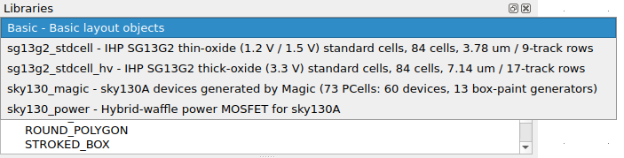
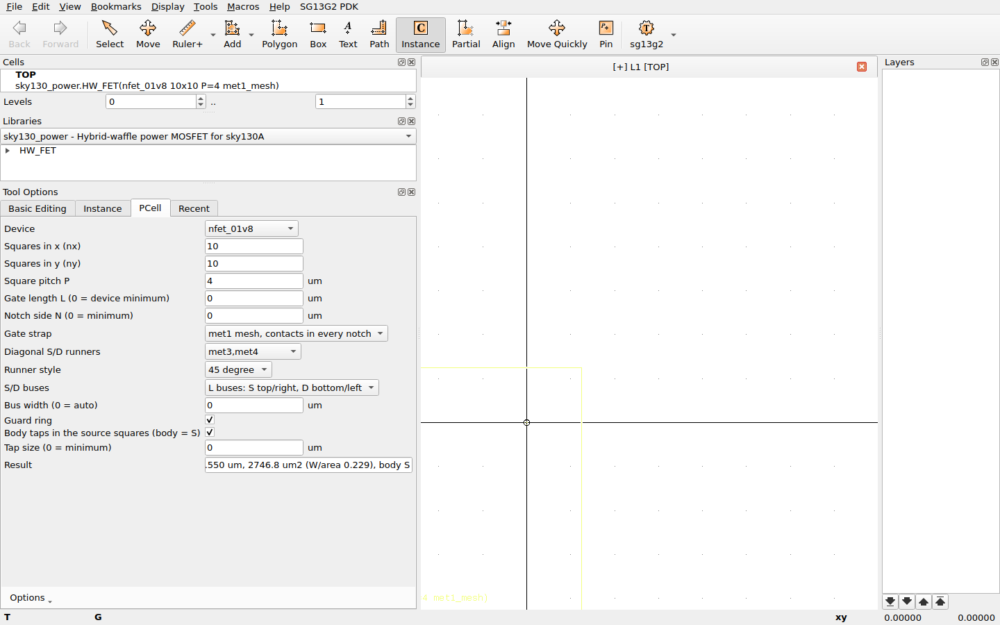
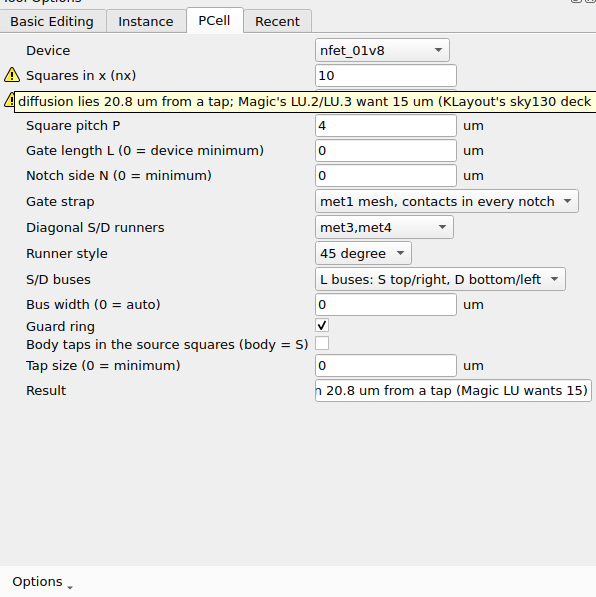
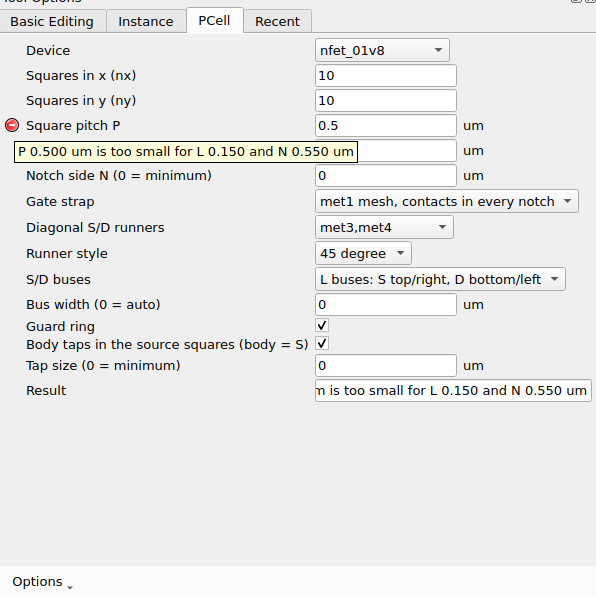
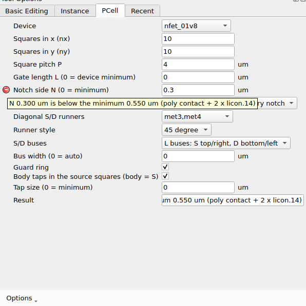
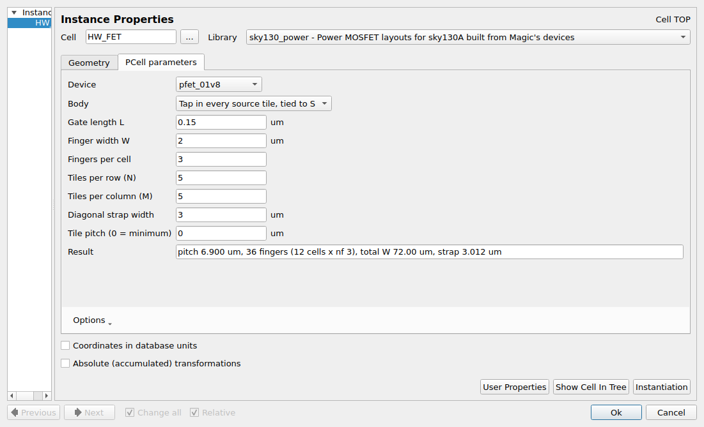
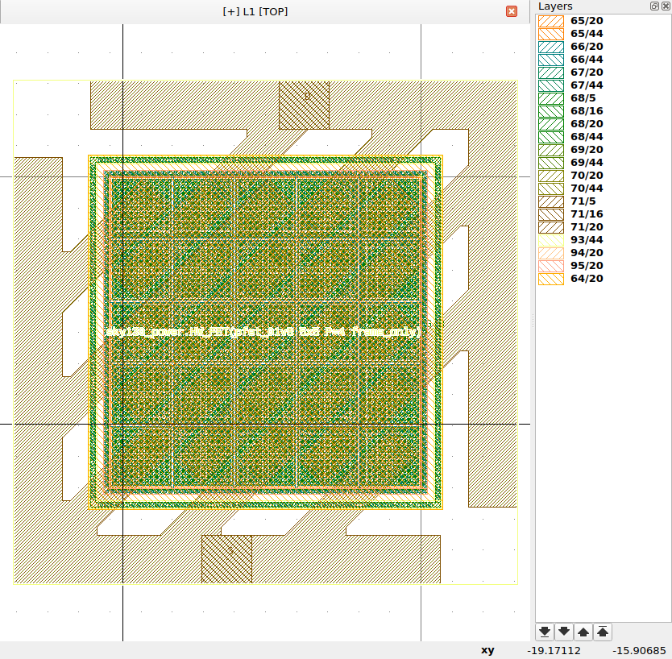
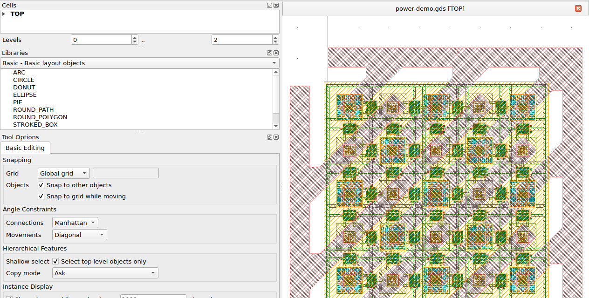

# sky130_power: the HW_FET PCell in KLayout

`sky130_power` is a KLayout library with one PCell, `HW_FET`: a sky130A
hybrid-waffle power MOSFET drawn from raw layers. Placing it needs only
KLayout. Magic and netgen are used by `verify` and by the tests.
[hybrid_waffle.md](hybrid_waffle.md) describes the geometry, the rule
table and the limits.

The screenshots were taken by `tools/screenshots/power_shots.sh` in KLayout
0.30.12 under Xvfb. `tests/power/test_gui.py` runs the same GUI sessions
and checks what they show.

## Installing

This repository is the Salt package `klayout-power-pcells`. It also holds
klayout-magic-pcells (`sky130_magic` and the other Magic libraries), so
install it **instead of** that package, not next to it:

```sh
git clone https://github.com/roshan0282/klayout-magic-pcells.git /foss/designs/klayout-power-pcells
git -C /foss/designs/klayout-power-pcells checkout hybrid-waffle-m1
mkdir -p ~/.klayout/salt
ln -s /foss/designs/klayout-power-pcells ~/.klayout/salt/klayout-power-pcells
```

When KLayout next starts, `pymacros/klayout_power_pcells.lym` (autorun)
registers `sky130_power`. Check the setup with:

```sh
PYTHONPATH=/foss/designs/klayout-power-pcells/python python3 -m klayout_power_pcells doctor
```

`doctor` prints:
- the cache settings;
- the stamp new cells get;
- whether `klayout`, `magic` and `netgen` are found (needed by `verify`
  only);
- the time it took to draw a 3x3 FET.

## Placing an HW_FET

`sky130_power` appears in the Libraries panel:



Choose `HW_FET` and the Instance tool. The PCell tab has the parameters of
the spec:

| Field | Meaning |
|---|---|
| Device | nfet_01v8, nfet_01v8_lvt, pfet_01v8, pfet_01v8_lvt, pfet_01v8_hvt, nfet_g5v0d10v5, pfet_g5v0d10v5, and the 16 V extended-drain (LDMOS) nfet_g5v0d16v0, pfet_g5v0d16v0 (P >= 6.80 / 6.48 um: every gate needs W >= 5 um) |
| nx, ny | squares per side |
| P | square pitch (um); 0 means the smallest pitch these values allow |
| L | gate length; 0 means the device minimum |
| N | notch side; 0 means the computed minimum |
| Gate strap | `met1_mesh` (contacts in every notch, met1 mesh) or `frame_only` |
| Runners | met3,met4 (default), met3, or met3,met4,met5 |
| Runner width | `diag45` and `staircase`: the stripe width across the stripe; 0 means the widest that fits P (under 3 um for diag45) |
| Runner style | `diag45` (45 degree stripes), `staircase` (the same stripes in 0/90 degree steps) or `planes` (0/90 only: S and D plates on alternate layers, islands where the other net passes; needs two runner layers) |
| S/D buses | `L_buses` (S top/right, D bottom/left) or `none` (a pin per stripe; with `planes`, one S and one D pin) |
| Bus width | 0 means 3.2 um |
| Guard ring | the tap ring around the array |
| Body taps in the source squares | on (default): a tap in every S square, body = S; off: body on pin B (the guard ring) |
| Tap size | 0 means the minimum (one contact) |
| Planes: net on met3 | `planes` only: `S` (default; S on met3, D on met4, S on met5) or `D` (D on met3, S on met4, D on met5) |
| Deep n-well | pfet_g5v0d16v0 only, on by default: a deep n-well under the array isolates the drift p-wells (the drains) from the substrate; needs the guard ring |
| Result | read-only: gates, total W, P (with "(min)" when P = 0), L, N, area and W per area |
| Minimums | read-only: what these values allow: the minimum L, N and P, the tap size and runner width ranges at this P, and the minimum bus width |



### What the form tells you

The form updates on every edit. The tool tip of each icon gives the reason:

- **A warning** on nx and ny means the diffusion lies more than 15 um from
  a tap. Magic's LU.2/LU.3 flag that; KLayout's sky130 deck doesn't. With
  the body taps in the source squares (the default) it can't happen. With
  them off, the 10 x 10 default is 20.8 um from the guard ring:

  

- **The Minimums line** gives the limits for the values in the form, so
  you don't need trial and error. For the default nfet:
  `L >= 0.150; N >= 0.550; P >= 2.180 um; tap_w 0.410-2.230 at P 4.000;
  runner_w 0.538-2.418 at P 4.000; bus_w >= 3.2`. The ranges are for the
  current P, or for the minimum P when the current P is too small. If a
  value is invalid, the line uses its default for the rest and says so.
  Set P to 0 to draw at the minimum.
- **An error** sits on the parameter the generator refuses, and the Result
  line says why. When a larger P would fix it, the message also gives the
  smallest P. Placing it anyway draws the error marker. Here P is too
  small:

  

  Here the notch is smaller than a poly contact plus twice licon.14:

  

A 4 x 4 FET, placed:


### Editing

Select the instance and open Properties (`Q`). Here the FET becomes a
`pfet_01v8` strapped at the frame only, on a 5 x 5 grid. The notch shrinks
to L + 2 x poly.4:





With `KMP_LAZY=1` the form shows an Update button instead of drawing on
every edit.

## Saving and reopening

The parameters are stored in the file.
- **With the package installed:** the cells reopen live, drawn again from
  the disk cache or the generator.
- **Without it:** they show as `<defunct>sky130_power.HW_FET` with the
  geometry stored in the file. Saving keeps that geometry, and installing
  the package makes them live again.




## From Python

```python
import sys
sys.path.insert(0, "/foss/designs/klayout-power-pcells/python")
import klayout.db as db
import klayout_power_pcells as kpp

lib = kpp.register()
v = kpp.form_values({"device": "pfet_01v8", "nx": 6, "ny": 6, "P": 4.0})   # adds the Result line
ly = db.Layout()
top = ly.create_cell("TOP")
fet = ly.create_cell("HW_FET", "sky130_power", v)
top.insert(db.CellInstArray(fet.cell_index(), db.Trans()))
ly.write("fet.gds")

# or a flat cell, without the library:
w = kpp.write_gds(kpp.WaffleParams(device="nfet_01v8", nx=6, ny=6), "flat.gds")
print(kpp.summary(w))
```

In batch: `klayout -b -rm pymacros/klayout_power_pcells.lym -r script.py`.

## Command line

```sh
python3 -m klayout_power_pcells doctor
python3 -m klayout_power_pcells devices
python3 -m klayout_power_pcells check nx=6 ny=6 device=pfet_01v8      # the minimums, then the summary or why not
python3 -m klayout_power_pcells hw nx=6 ny=6 P=0 -o min.gds           # at the smallest pitch
python3 -m klayout_power_pcells generate nx=6 ny=6 -o fet.gds         # through the library, in TOP
python3 -m klayout_power_pcells hw nx=6 ny=6 -o flat.gds              # flat, no library
python3 -m klayout_power_pcells verify nx=3 ny=3 device=nfet_g5v0d10v5 --keep /tmp/v
python3 -m klayout_power_pcells audit design.gds --regen
python3 -m klayout_power_pcells cache stats                           # also: prune, clear
```

`verify` draws the FET and then runs:
- the PDK's KLayout deck;
- Magic's `drc(full)`;
- Magic extraction and netgen LVS against one device of W = W_total.

```
$ python3 -m klayout_power_pcells verify nx=3 ny=2 device=nfet_g5v0d10v5
HW nfet_g5v0d10v5 3x2, P 4.000, L 0.500, N 0.650 um: 7 gates, W_total 23.90 um, ...
KLayout DRC (sky130A_mr.drc): clean
Magic DRC (drc(full)): clean
extracted 7 devices, W 23.900 um; LVS against one device of W 23.900: match
```

Exit status:
- **0:** drawn, and for `verify` everything passes;
- **1:** not drawn, or a check fails (including `audit` problems);
- **2:** a value that isn't a number or isn't one of the choices.

## Configuration

`sky130_power` uses klayout-magic-pcells' settings:
- **`KMP_CACHE_DIR`, `KMP_CACHE`:** the disk cache. `KMP_CACHE=0` keeps
  nothing between sessions.
- **`KMP_LAZY`:** the Update button.
- **`PDK_ROOT`:** where `verify` finds the decks.

Drawing doesn't use Magic.

## The cache

A 10 x 10 FET takes about 3 s to draw, so finished FETs are cached:
- **Location:** `<KMP_CACHE_DIR>/power/v1/<versions digest>/HW_FET/<key>.gds`,
  plus a sidecar with the request, the report and the stamp.
- **Key:** covers the request and the generator's source (`waffle.py`,
  `rules.py`), so a changed rule or generator starts new entries.
- **Damage:** an entry whose GDS no longer matches its SHA-256 is drawn
  again.
- **Unwritable directory:** the library registers without the disk cache
  and logs a warning.
- **Management:** `cache prune` removes old versions directories, and
  `cache clear` removes everything.

## Stamps and audit

Every variant carries
`hw2;version=0.6.0;code=<12 hex>;pdk=sky130A;rules=<12 hex>`:
- **Generated by:** a GDS property (attribute 100) on one shape, with
  `;key=...;grid=...` added.
- **Created with:** the hidden parameter `hw_created`. A cell reopened under
  another generator or rule table logs `instance created with ..., drawn
  again with ...`.

`audit FILE` reports, for each HW_FET cell:
- the error marker;
- empty cells;
- a missing stamp;
- stamps from another generator or rule table;
- a file dbu that can't hold the 5 nm grid.

`--regen` draws every cell again and compares it with what the file stored.

## If something fails

Values the generator refuses (or any failure while drawing) leave the cell
with a 1 x 1 um box and the text `HW_ERROR HW_FET: <reason>` on 255/0, and
the log says why. `audit` reports it, and `generate` exits 1.

## Tests

```sh
KMP_PDKS=sky130A python3 -m unittest discover -s tests/power -t .   # inside the image
scripts/test_power.sh                                               # from outside, in the pinned image
```

- `test_unit`: stamps, requests, CLI parsing, the declaration, packaging.
- `test_waffle`:
  - the geometry checks (gate count, W formulas, notch minimums, refusals,
    `fill_cuts`);
  - KLayout DRC, Magic DRC and LVS on 13 cases;
  - the 10 x 10 default (clean in KLayout, LU.2 only in Magic, LVS
    matching).
- `test_pcell`:
  - the PCell's geometry is identical to `write_gds`;
  - a placed instance passes `verify`;
  - a GDS round trip;
  - the error marker;
  - the autorun macro under `klayout -b`.
- `test_backend`, each scenario in new processes:
  - the cache, stamps, GDS/OASIS round trips with and without the library,
    a library refresh, host dbu 0.5/5 nm;
  - `audit`, every CLI command, the form's icons, `KMP_LAZY`;
  - registering and drawing with Magic absent.
- `test_gui`: the GUI sessions above under Xvfb. Skipped without
  `xvfb-run` or the Salt link.
