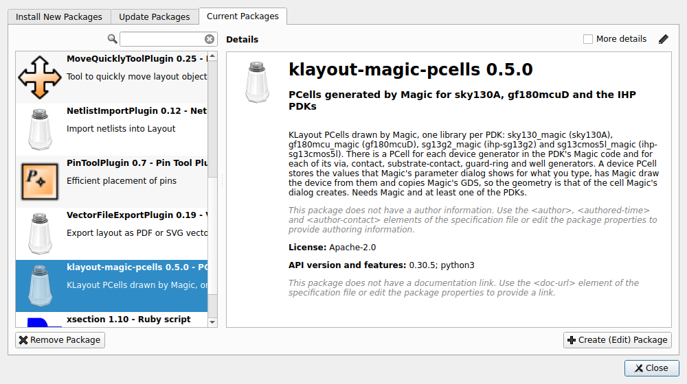
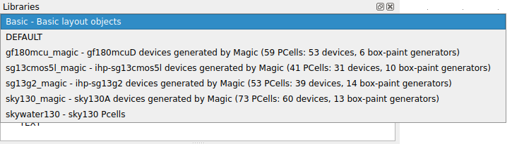
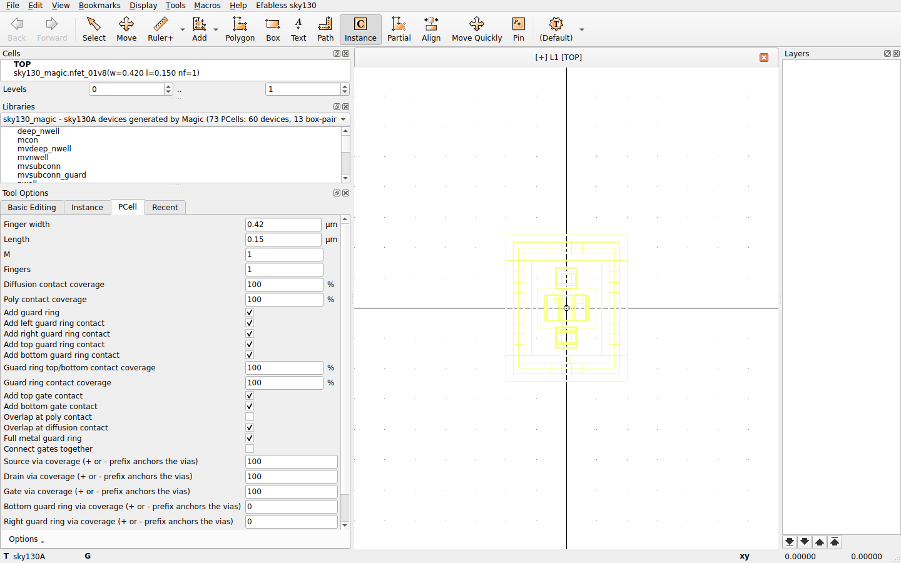
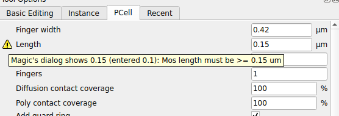
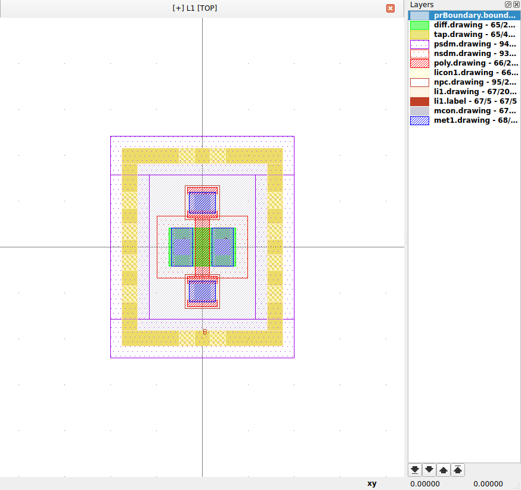
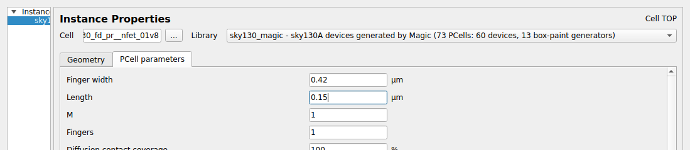
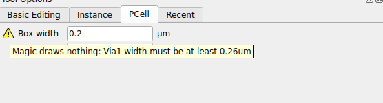
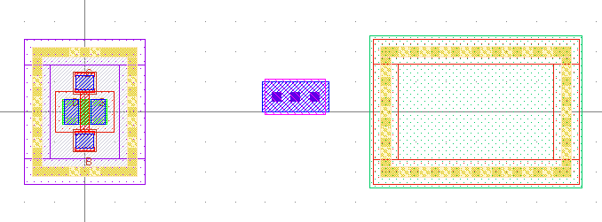
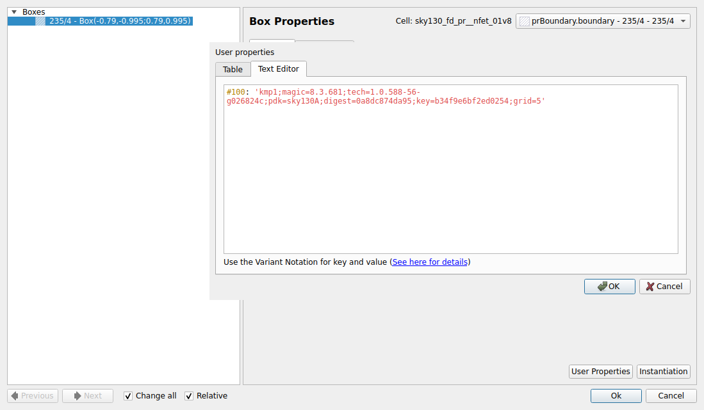
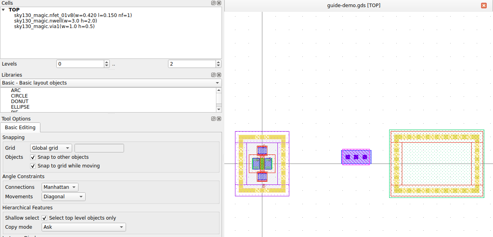

# Using klayout-magic-pcells

This guide shows how to install the package in KLayout, place and edit
devices, and use its command line and test harness. It is for someone who
already has KLayout and Magic with at least one of the supported PDKs
(sky130A, gf180mcuD, ihp-sg13g2 or ihp-sg13cmos5l), for example in the
[IIC-OSIC-TOOLS](https://github.com/iic-jku/IIC-OSIC-TOOLS) Docker image,
whose own documentation says how to start it with a desktop.
[README.md](README.md) describes the package in full; this guide links to
it where the details are.

Everything below was run on 2026-11-23 in the image
`hpretl/iic-osic-tools@sha256:3c371645b19c6f6564dc8c7b21e39ad1c1833d274fe5b85639afe1ba9d7987e7`
(KLayout 0.30.11, Magic 8.3.681, sky130A from open_pdks 026824c7), with the
image's `PDK` variable set to `sky130A` and the repository mounted into the
container at `/foss/designs/klayout-magic-pcells`, as
`tools/screenshots/take.sh` mounts it. In your own setup, use the folder you
cloned the repository into wherever this guide writes that path. The
screenshots are of KLayout's GUI under Xvfb, driven by a macro (see [How the
screenshots were made](#how-the-screenshots-were-made)). They use a white
canvas; the image's own `klayoutrc` sets a black one.

## Contents

1. [Install the package](#install-the-package)
2. [Choose the PDKs](#choose-the-pdks)
3. [Find the libraries](#find-the-libraries)
4. [Place a device](#place-a-device)
5. [Edit a placed device](#edit-a-placed-device)
6. [Via, contact and well PCells](#via-contact-and-well-pcells)
7. [Stamps on a generated cell](#stamps-on-a-generated-cell)
8. [Save and reopen](#save-and-reopen)
9. [The command line](#the-command-line)
10. [The parity harness](#the-parity-harness)
11. [How the screenshots were made](#how-the-screenshots-were-made)

## Install the package

The repository is a KLayout Salt package. Clone it to a folder of your own
(`git clone https://github.com/vproHacks/klayout-magic-pcells.git`), then
link that folder into the `salt` folder of your KLayout home, `~/.klayout`.
Outside the image, make the `salt` folder first if it doesn't exist
(`mkdir -p ~/.klayout/salt`). In the image, the home directory is
`/headless` and the `salt` folder exists; this is the link that the run for
this guide made:

```sh
ln -s /foss/designs/klayout-magic-pcells ~/.klayout/salt/klayout-magic-pcells
```

Start KLayout, or restart it if it is running. At start-up it runs the
package's autorun macro, which starts one Magic process for each PDK it
selects (by default every installed one; see [Choose the
PDKs](#choose-the-pdks)) and registers a library for it. Tools > Manage
Packages then lists the package under Current Packages:



For this guide the package was installed with the link above and checked
only in this list. Installing through the Package Manager's Install tab, or
with `klayout -y`, has not been tried.

`doctor` checks the setup from a shell. It prints each setting and where it
came from, then starts Magic for each selected PDK, compares Magic's device
defaults with the manifest the package ships, and times one generation. It
needs the package's `python` folder on `PYTHONPATH`, as do all the
`python3 -m klayout_magic_pcells` commands in this guide:

```
$ cd /foss/designs/klayout-magic-pcells
$ export PYTHONPATH=$PWD/python
$ python3 -m klayout_magic_pcells doctor --pdk sky130A
configuration (config file: none)
  magic          /foss/tools/bin/magic                                        default (PATH, then /foss/tools/bin/magic)
  pdk_root       /foss/pdks                                                   env PDK_ROOT
  pdks           sky130A, gf180mcuD, ihp-sg13g2, ihp-sg13cmos5l               default (auto: the supported PDKs installed under PDK_ROOT)
  cache_dir      /headless/.cache/klayout-magic-pcells                        default ($XDG_CACHE_HOME or ~/.cache)/klayout-magic-pcells
  cache_enabled  True                                                         default
  backend        server                                                       default
  timeout        30.0                                                         default
  lazy           False                                                        default (1 with oneshot, 0 with server)
  log            None                                                         default (off)
klayout module 0.30.11

sky130A -> library sky130_magic
  magicrc        /foss/pdks/sky130A/libs.tech/magic/sky130A.magicrc           default ($PDK_ROOT/<pdk>/libs.tech/magic/<pdk>.magicrc)
  manifest       /foss/designs/klayout-magic-pcells/python/klayout_magic_pcells/data/manifest-sky130A.json default (shipped)
  Magic started in 0.31 s: Version 8.3 revision 681.  Compiled on Tue Aug 25 11:50:23 AM CEST 2026.
  magic 8.3.681, tech 1.0.588-56-g026824c (sky130A), PDK commit 026824c7969ce6f4fc9678e6ca04b0a06a596c4b, namespace sky130, Tcl 8.6.14
  manifest matches the running Magic (60 devices, 13 box-paint generators)
  sky130_fd_bs_flash__special_sonosfet_star defaults generated in 25.2 ms (sky130_fd_bs_flash__special_sonosfet_star_BXHNFL)
```

## Choose the PDKs

By default every supported PDK whose Magic rcfile exists under `PDK_ROOT`
registers: in the image that is all four, sky130A, gf180mcuD, ihp-sg13g2 and
ihp-sg13cmos5l. Each registered PDK keeps a Magic process running for the
whole KLayout session, so if you use one PDK, name it.

The environment variable `KMP_PDKS` takes the PDKs separated by commas or
spaces:

```
$ KMP_PDKS=gf180mcuD python3 -m klayout_magic_pcells devices | head -4
gf180mcuD (library gf180mcu_magic)
  cap_mim_2p0fF  [mim_cap]
  diode_nd2ps_03v3  [diode]
  diode_nd2ps_06v0  [diode]
```

The same setting can go in `~/.config/klayout-magic-pcells/config.ini`,
section `[kmp]`, with the key written in lower case without `KMP_`. This
helps when KLayout starts from a desktop launcher that doesn't pass on your
shell's environment:

```
$ cat ~/.config/klayout-magic-pcells/config.ini
[kmp]
pdks = sky130A, ihp-sg13g2

$ python3 -m klayout_magic_pcells doctor | head -4
configuration (config file: /headless/.config/klayout-magic-pcells/config.ini)
  magic          /foss/tools/bin/magic                                        default (PATH, then /foss/tools/bin/magic)
  pdk_root       /foss/pdks                                                   env PDK_ROOT
  pdks           sky130A, ihp-sg13g2                                          /headless/.config/klayout-magic-pcells/config.ini [kmp] pdks
$ python3 -m klayout_magic_pcells devices | grep -v "^  "
sky130A (library sky130_magic)
ihp-sg13g2 (library sg13g2_magic)
```

The environment wins over the file. The package reads `KMP_PDKS` and
ignores the image's `PDK` variable. The other settings (the Magic
executable, the cache, a rebuilt manifest, per-PDK rcfiles) are in the
README's [Configuration](README.md#configuration) table.

## Find the libraries

Open a layout, or make one with File > New Layout. The screenshots use a
new layout with the sky130A technology and a top cell named `TOP`; once the
layout has shapes, the Layers panel shows them with sky130A's layer names
and colours.

View > Libraries shows the Libraries panel. Its list holds one library per
registered PDK, named `sky130_magic`, `gf180mcu_magic`, `sg13g2_magic` and
`sg13cmos5l_magic`, with the PCell counts in the description:



`Basic` comes with KLayout. `DEFAULT` and `skywater130`, the sky130A PDK's
own PCell library, come from the image's own KLayout setup. The `*_magic`
libraries aren't bound to a technology, so KLayout lists them whatever the
layout's technology is.

The PCells carry Magic's device names (`sky130_fd_pr__nfet_01v8`,
`nfet_03v3`, `sg13_lv_nmos`) and the names of Magic's box-paint generators,
the via, contact and well commands described under [Via, contact and well
PCells](#via-contact-and-well-pcells) (`via1`, `nwell`, `subconn_guard`).
The README's [Devices](README.md#devices) section lists them all.

## Place a device

Press Instance in the toolbar. In the Instance tab of the Tool Options
panel, set the library to `sky130_magic` and the cell to
`sky130_fd_pr__nfet_01v8`. The PCell tab then shows the device's
parameters, which are the entries, checkboxes and choices of Magic's own
parameter dialog for that device, with its labels. KLayout draws the
device at the pointer, before you place it:



Finger width (`w`) is the width of one finger, as in Magic: `w` 1.5 with
Fingers (`nf`) 3 is 4.5 µm of total width.

### When Magic corrects a value

The values the PCell stores are the ones Magic's parameter dialog shows
after you type yours. When you change a field and press Return, the
package's own Magic process types the value into the device's "New device"
dialog, presses Return and then the dialog's Create button, as you would in
Magic. The form then shows what that dialog shows. Typing 0.1 into Length
gives 0.15, Magic's minimum length for this nfet, and the field gets a
warning icon. Its tooltip quotes Magic:



The same message goes to KLayout's log (File > Log Viewer). The device is
drawn and stored with `l` = 0.15, which is what the cell would be if you
had typed 0.1 into Magic's own dialog. The correction comes from the PDK's
`_check` procedure and the dialog's callbacks, run in Magic. The README's
[Values as Magic's dialog shows
them](README.md#values-as-magics-dialog-shows-them) has the model and more
examples.

A value Magic's dialog shows in SPICE notation shows as a number. On
`sky130_fd_pr__res_high_po_0p69`, for example, the Value field shows 1028
with a warning icon whose tooltip reads `Magic's dialog shows 1.028k here,
which this field can only show as 1028.0`.

KLayout's PCell tab doesn't hand the PCell the dialog state that it
stores for a variant (a run that logged what KLayout passed to the PCell
showed that state empty in this tab). So each change in the tab goes into a fresh
New device dialog, together with every other field that differs from
Magic's defaults, including fields that only Magic changed. On
`sky130_fd_pr__cap_mim_m3_1`, typing 5 into Length put a warning on Value,
`Magic's dialog shows 22.66 (entered 9.52)`, and typing 3 into Width then
gave `Magic's dialog shows 33.04 (entered 22.66)`, although Value was never
typed. Editing a placed instance through its Properties dialog keeps the
state (see [Edit a placed device](#edit-a-placed-device)).

### Placing the instance

Click in the layout to place the device. KLayout makes one cell, a
variant, for each set of parameter values, and places it. If the device
shows as an empty frame with its name, choose Display > Full Hierarchy; the
shapes are one level below the top cell. This is the placed nfet with
sky130A's layer colours:



The Cells panel lists the variant as
`sky130_magic.nfet_01v8(w=0.420 l=0.150 nf=1)`, with the values Magic's
dialog shows.

## Edit a placed device

Select the instance and choose Edit > Properties. The Instance Properties
dialog has a PCell parameters tab with the same fields. Type a value and
leave the field (Tab, or a click into another field): KLayout changes the
instance at once. Return in a field presses the dialog's Ok button.

For a placed instance, a change is the one that Magic's "Edit device"
dialog and its Apply button would make. The package's Magic process starts
from what Magic's dialog showed for the instance, types the change and
presses Apply. In the run below, Finger width was typed as 1.0 (the
instance became `w=1.0`) and then as 0.3. Magic's dialog shows 0.42 for
that, so the field reads 0.42 and the instance went back to `w=0.420`:



This dialog showed no icon for the correction; the warning is in the Log
Viewer (File > Log Viewer), as the last of three. The first is the Length
correction from [When Magic corrects a value](#when-magic-corrects-a-value),
and the second comes from the via in the next section, which the run
placed before it made this edit:


## Via, contact and well PCells

The via, contact, substrate-contact, guard-ring and well commands of
Magic's Devices menus paint into the cursor box instead of opening a dialog.
Each has a PCell with two parameters, the box's width `w` and height `h` in
µm, and the PCell draws what Magic paints into a box of that size at the
origin. With no dialog in Magic, these PCells keep the size you type; Magic
rounds it to its 5 nm grid.

Below a generator's minimum box, Magic paints nothing and prints a message.
The PCell then draws an empty cell, and the side the message names gets a
warning icon. `via1` with a width of 0.2 µm:



With `w` 1.0 and `h` 0.5, `via1` draws three via cuts with metal1 and
metal2 around them. The `nwell` PCell is Magic's "n-well region with guard
ring (1.8V)" command; with `w` 3.0 and `h` 2.0 it draws the n-well with a
guard ring whose contact strips are centred on the box's edges. A
box-paint PCell's origin is its box's lower-left corner. Here are the nfet,
the via placed at (3, 0) µm and the n-well placed at (5, -1) µm:



The README's [Box-paint generators](README.md#box-paint-generators) section
lists every generator with its minimum box.

## Stamps on a generated cell

Each variant holds a flat copy of the GDS that Magic wrote for it, and two
stamps that record which Magic, PDK and generator code made it.

The first stamp is a GDS property, attribute 100, on one shape of the
cell: the prBoundary box (235/4) on sky130A devices that have one. KLayout
shows it under the shape's Edit > Properties > User Properties. In this
screenshot the macro selected the nfet's boundary box inside the instance
and opened that dialog:



The fields are the Magic version, the PDK's tech version and name, a digest
over the generator code and the PDK's Magic and vendor files, the first 16
hex digits of the cache key, and the coarsest grid, in nm, that all of the
cell's coordinates lie on. The property stays in the file when it is saved
as GDS or OASIS.

The second stamp is a hidden PCell parameter, `kmp_created`, which KLayout
saves with the other parameters. For the nfet above it holds
`kmp1;magic=8.3.681;tech=1.0.588-56-g026824c;pdk=sky130A;digest=0a8dc874da95`.
When a file is opened again under another Magic, another PDK version or
edited generator code, the PCell logs a warning that the instance was
created with one stamp and regenerated with another. A third hidden
parameter, `kmp_dialog`, holds the state of Magic's dialog for the instance
(the form that Create or Apply was pressed with, and what the dialog showed
afterwards), so that reopening a file doesn't type the values into Magic's
dialog again.

`audit` reads these stamps from a file; see [The command
line](#the-command-line). The README's [Stamps and
audit](README.md#stamps-and-audit) section has the details.

## Save and reopen

Save the layout as usual. KLayout stores each PCell instance as its library
name, PCell name and parameters, together with a copy of the geometry.

When the file is opened with the libraries registered, KLayout draws every
variant again, from the package's disk cache or by asking Magic. The values
stay as they were saved: Magic's dialog doesn't run again on them, and the
Log Viewer stayed empty when this file was reopened. The Cells panel shows
the live PCells:



Opened in a session where `sky130_magic` isn't registered (here
`KMP_PDKS=gf180mcuD`), the same cells show as `<defunct>` and keep the
geometry saved in the file (and, the README says, saving keeps it):


A restart with sky130A selected again registers its library. The README
says that `klayout_magic_pcells.register()` in the macro console, called
after the setting is fixed, also registers it, and that the open cells then
come back as live PCells. Neither step is shown here.

## The command line

The package has a command line for the shell. It needs the package's
`python` folder on `PYTHONPATH` and the `klayout` Python module, which the
image has (elsewhere, `pip install klayout`; the README's
[Requirements](README.md#requirements) give the version tested). A device
name is looked up in the selected PDKs; a name that several PDKs have, such
as `via1`, needs `--pdk`.

`devices` lists the PCells, and with `-v` their parameters:

```
$ python3 -m klayout_magic_pcells devices -v --pdk sky130A | sed -n "/^  sky130_fd_pr__nfet_01v8 /,/^  sky130_fd_pr__nfet_01v8_lvt/p" | head -12
  sky130_fd_pr__nfet_01v8  [mos]
      w          float   default 0.420    Width (um)
      l          float   default 0.150    Length (um)
      m          int     default 1        M
      nf         int     default 1        Fingers
      diffcov    float   default 100      Diffusion contact coverage (%)
      polycov    float   default 100      Poly contact coverage (%)
      guard      bool01  default 1        Add guard ring
      glc        bool01  default 1        Add left guard ring contact
      grc        bool01  default 1        Add right guard ring contact
      gtc        bool01  default 1        Add top guard ring contact
      gbc        bool01  default 1        Add bottom guard ring contact
```

`check` types values into Magic's New device dialog, as the PCell form
does, presses Create, and prints what the dialog then shows that differs
from what you typed, with Magic's messages:

```
$ python3 -m klayout_magic_pcells check sky130_fd_pr__nfet_01v8 w=0.1 l=0.1
sky130_fd_pr__nfet_01v8: Magic's dialog shows w=0.42 (entered 0.1)
sky130_fd_pr__nfet_01v8: Magic's dialog shows l=0.15 (entered 0.1)
  message: Mos width must be >= 0.42 um
  message: Mos length must be >= 0.15 um
$ python3 -m klayout_magic_pcells check sky130_fd_pr__res_high_po_0p69 w=1.0
sky130_fd_pr__res_high_po_0p69: Magic's dialog shows w=0.69 (entered 1.0)
sky130_fd_pr__res_high_po_0p69: Magic's dialog sets val=1.028k
  message: Resistor width must be <= 0.690 um
```

For a box-paint generator it prints the box Magic paints, after rounding to
the 5 nm grid, or that Magic paints nothing:

```
$ python3 -m klayout_magic_pcells check --pdk sky130A via1 w=0.2 h=1.0
via1: Magic paints nothing on a 0.2 x 1.0 um box
  message: Via1 width must be at least 0.26um
$ python3 -m klayout_magic_pcells check --pdk sky130A via1 w=0.263 h=1.0
via1: Magic paints a 0.265 x 1.0 um box (entered 0.263 x 1.0)
$ python3 -m klayout_magic_pcells check via1 w=1 h=1
error: via1 is a device of sky130A, gf180mcuD, ihp-sg13g2, ihp-sg13cmos5l; choose one with --pdk
```

`check` exits 0 when Magic draws something and 1 when it draws nothing or
fails (the first `via1` above, and the last one, whose name is ambiguous).
It exits 2 for a value it refuses.

`generate` places one variant in a new layout and writes it to a file. It
stores the values Magic's dialog shows, as the GUI does, and prints the
dialog's correction as a warning:

```
$ python3 -m klayout_magic_pcells generate sky130_fd_pr__nfet_01v8 w=1.5 l=0.5 nf=3 -o nfet.gds
wrote nfet.gds: sky130_fd_pr__nfet_01v8__kmp_43604ed3 (sky130_magic.nfet_01v8(w=1.5 l=0.5 nf=3)), bbox (-1.965,-1.745;1.965,1.745) um
$ python3 -m klayout_magic_pcells generate sky130_fd_pr__nfet_01v8 l=0.1 -o nfet_short.gds
Warning: sky130_magic nfet_01v8: Magic's dialog shows l=0.15 (entered 0.1): Mos length must be >= 0.15 um
wrote nfet_short.gds: sky130_fd_pr__nfet_01v8__kmp_7fef7f47 (sky130_magic.nfet_01v8(w=0.420 l=0.150 nf=1)), bbox (-1,-1.205;1,1.205) um
```

`audit` reads a file without registering a library and reports the cells
of the four libraries: cells with the error marker, without a stamp, with no
shapes, stamped by another Magic, PDK or generator code, or whose
coordinates the file's database unit would round. With `--regen` it also
generates every cell again with the installed Magic and compares the
geometry. It exits 1 when it finds a problem.

```
$ python3 -m klayout_magic_pcells audit nfet.gds
nfet.gds: dbu 0.001 um
  sky130_fd_pr__nfet_01v8__kmp_43604ed3  ok
1 sky130_magic cells, 0 with problems
$ python3 -m klayout_magic_pcells audit nfet.gds --regen
nfet.gds: dbu 0.001 um
  sky130_fd_pr__nfet_01v8__kmp_43604ed3  ok
      regenerated: same as stored
1 sky130_magic cells, 0 with problems
```

The disk cache keeps Magic's GDS for each variant, so that reopening a file
needs no Magic call for variants already generated. Its entries sit in one
directory per PDK and set of versions (Magic, PDK, generator code, cache
format). `cache stats` counts them, `cache prune` deletes the directories
of older versions of the selected PDKs, and `cache clear` deletes every
entry:

```
$ python3 -m klayout_magic_pcells cache stats
{
 "entries": 2,
 "bytes": 20305,
 "versions": 1,
 "current": {
  "sky130A": "3341d4166cfc",
  "gf180mcuD": "6f871b6afc95",
  "ihp-sg13g2": "93c824bbab27",
  "ihp-sg13cmos5l": "e84b87de276f"
 },
 "pdk_of": {
  "3341d4166cfc": "sky130A"
 },
 "root": "/headless/.cache/klayout-magic-pcells"
}
$ python3 -m klayout_magic_pcells cache prune --pdk sky130A
{
 "entries": 2,
 "bytes": 20305,
 "versions": 1,
 "current": {
  "sky130A": "3341d4166cfc"
 },
 "pdk_of": {
  "3341d4166cfc": "sky130A"
 },
 "root": "/headless/.cache/klayout-magic-pcells"
}
$ python3 -m klayout_magic_pcells cache clear
cleared /headless/.cache/klayout-magic-pcells
```

The two entries are the two `generate` runs; `check` doesn't use the cache.
With nothing older to delete, `prune` removed no directory and printed only
the statistics.

The README's [Usage](README.md#usage) section shows the package from a
KLayout batch script (`klayout -b -rm ...`) and from plain Python, with
`dialog_values()` for the values the GUI would store.

## The parity harness

`scripts/parity.sh` checks the PCells against Magic. For a sweep of
parameter values per device, it compares what the PCell stores and draws
with what Magic's own dialog shows and draws when the same values are typed
into it, layer by layer, label by label, with no tolerance; for a box-paint
generator, with what Magic paints into the box. It also runs the unit and
backend tests, checks the manifests against Magic, runs DRC with both tools
on both sides, and reopens saved files. The README's [Parity
definition](README.md#parity-definition) and [Tests](README.md#tests)
sections describe every check. It needs Docker and the pinned image: each
PDK runs in its own container.

Without options, the script runs the full sweep on all four PDKs. `--pdk`
picks one PDK, `--quick` sweeps only each generator's defaults, and
`--devices` takes a pattern of device names; the README's
[Tests](README.md#tests) section lists the options. The quick run on sky130A
took 4 minutes 38 seconds. This is its console output, without the `[INFO]`
lines the image prints when a container starts:

```
$ scripts/parity.sh --pdk sky130A --quick
[23:29:24] step 0: unit and backend tests
[23:29:31] tests/unit: {'rc': 0, 'ran': 96, 'failures': 0, 'errors': 0, 'skipped': 0, 'ok': True, 'log': 'test_unit.log'}
[23:30:38] tests/backend: {'rc': 0, 'ran': 42, 'failures': 0, 'errors': 0, 'skipped': 1, 'ok': True, 'log': 'test_backend.log'}
[23:30:38] step 1: versions and the manifest check
[23:30:41]   MANIFEST OK: /repo/python/klayout_magic_pcells/data/manifest-sky130A.json matches the installed Magic and sky130A (60 devices, 13 box-paint generators)
[23:30:41] step 2: sweep
[23:30:41]   73 points
[23:30:41] step 3+4: path A, path D (Magic's dialog, under Xvfb) and path B (cold) in parallel
[23:30:49]   path A 1.5 s, path D 7.6 s, path B 4.4 s {'memo': 240, 'disk': 0, 'magic': 73, 'evicted': 0, 'dialog_memo': 0, 'dialog_disk': 0, 'dialog_magic': 0}
[23:30:49] step 4: path B (warm)
[23:30:52]   warm 3.0 s {'memo': 240, 'disk': 73, 'magic': 0, 'evicted': 0, 'dialog_memo': 0, 'dialog_disk': 0, 'dialog_magic': 0}
[23:30:52] step 5: per-point checks
[23:30:52] step 5b: the dialog's bindings against the server's
[23:30:52]   60 devices (60 records), 60 records with the same bindings
[23:30:52] step 5c: box-paint generators through Magic's menu, under Xvfb
[23:31:14]   13 points through the menu entries (deep n-well region (1.8V), deep n-well region (5.0V), mcon, n-well region with guard ring (1.8V), n-well region with guard ring (5.0V), substrate contact (1.8V), substrate contact (5.0V), substrate guard ring (1.8V), substrate guard ring (5.0V), via1, via2, via3, via4)
[23:31:14] step 6: round trips
[23:31:19] building DRC sheets
[23:31:19] step 7: DRC (219 sheets; KLayout: sky130A_mr.drc with beol=true, feol=true, floating_met=false, offgrid=true, seal=false, thr=1)
[23:34:01]   DRC 161.5 s, 0 unassigned markers
[23:34:01] step 8: extraction of MOSFET points
PARITY PASS 73/73
```

Path A is Magic's `magic::gencell` called with the typed values, path D is
Magic's real parameter dialog driven under Xvfb, and path B is the PCell in
`klayout -b`, first with an empty cache and then from the cache. The last
line gives the result: `PARITY PASS n/n` when every point passed every check,
`PARITY FAIL` with the number of failed points otherwise. The script exits
0 on a pass, 1 when a check fails and 2 when the harness itself fails.

The report is in `out/parity/sky130A/report.md` (and `report.json`). It
starts with the versions it ran with and the test results:

```
# Parity report

**PARITY PASS 73/73**

| | |
|---|---|
| pdk | `sky130A` |
| library | `sky130_magic` |
| image | `hpretl/iic-osic-tools@sha256:3c371645b19c6f6564dc8c7b21e39ad1c1833d274fe5b85639afe1ba9d7987e7` |
| magic | `8.3.681` |
| tech | `1.0.588-56-g026824c` |
| pdk_commit | `026824c7969ce6f4fc9678e6ca04b0a06a596c4b` |
| klayout | `0.30.11` |
| klayout_drc | `sky130A_mr.drc with beol=true, feol=true, floating_met=false, offgrid=true, seal=false, thr=1` |
| repo | `ed4d324fba0aed538311845643f14e7b71425a4a` |
| seed | `1121` |
| points | `73` |
| seconds | `277.5` |
```

`repo` is the commit the run used. The history was squashed into version
0.5.0 afterwards, and that commit's plugin and harness code is the same as
`v0.5.0`'s.

Then come the results per device family and per device; a failed check
shows its name in the last column:

```
| family | points | pass | fail | failed checks |
|---|---|---|---|---|
| mos | 12 | 12 | 0 | - |
| varactor | 3 | 3 | 0 | - |
| res | 22 | 22 | 0 | - |
| mim_cap | 2 | 2 | 0 | - |
| diode | 8 | 8 | 0 | - |
| photodiode | 1 | 1 | 0 | - |
| fixed | 12 | 12 | 0 | - |
| box_paint | 13 | 13 | 0 | - |
```

After the steps' timings, a section lists Magic behaviour the sweep met
but doesn't count as a failure, such as the points where Create's own
`_check` changes the dialog's form (31 of the 73 here, for example
`sky130_fd_pr__res_high_po_0p69` default: `{"val": ["463.480", "1.028k"]}`),
and the last section lists the `_draw` procs that aren't PCells and why.

Without `--pdk`, the script runs the four PDKs one after another and also
writes `out/parity/summary.md`. The README's [Last full
run](README.md#last-full-run) section has the results of the latest full
run over the four PDKs.

## How the screenshots were made

The scripts in [tools/screenshots](tools/screenshots) made every image in
this guide and the transcripts of [The command line](#the-command-line)
and of `doctor` and the PDK settings. The parity transcript and report are
from the run of `scripts/parity.sh` shown above.

- `take.sh` starts the pinned image, links the package into the salt
  folder as in [Install the package](#install-the-package), and runs
  KLayout three times under Xvfb with the macro `gui.py`: once to place
  and edit the devices and save `guide-demo.gds`, once to reopen it, and
  once to reopen it with `KMP_PDKS=gf180mcuD`. `finish.py` writes the PNGs
  to `docs/img/guide/`.
- `gui.py` drives KLayout through its own Qt bindings (`qtdrive.py`): it
  triggers menu actions, sends key and mouse events to the widgets, and
  grabs the screen with `QScreen.grabWindow`. Some steps use KLayout's API
  where a user would click: it sets the Instance tab's library and cell
  through KLayout's configuration, creates the new layout with
  `create_layout`, and selects the instance and the boundary box with
  `object_selection`.
- `cli.sh` prints the command-line transcripts.

```sh
tools/screenshots/take.sh
tools/screenshots/cli.sh > cli.txt
```
